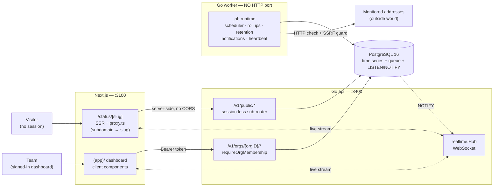
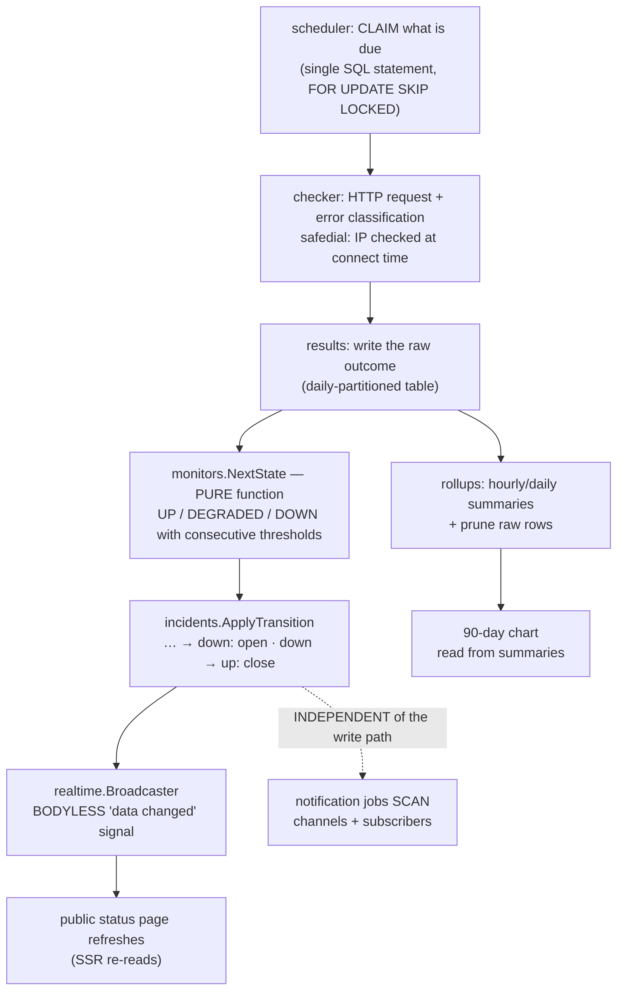

# Uptime Mini

A multi-tenant **uptime monitoring + public status page** service — Go (two
independent processes: `api` and `worker`), PostgreSQL (no ORM: goose
migrations + sqlc code generation), Next.js (CSS Modules, single dark theme).

In one sentence: you enter the addresses you want watched, a background worker
checks them on their own schedules, a state machine decides when a service is
actually down, incident records open and close by themselves, and all of it
appears on a visitor-facing status page — without a page reload.

A stranger can sign up and run a team on it: registration, team invitations,
password reset, plans and quotas, and — the part most monitoring demos get
wrong — an explicit signal when the checker itself has stopped measuring.

Email and payments are still **mocked**. Both sit behind an interface, and
switching to a real provider is a one-line change in a single constructor
(see *[Deliberate limits](#deliberate-limits)*).

**No external account, API key, or payment is required.** Cloning the repo and
getting to a working demo takes three commands (below).

---

## Contents

- [Architecture](#architecture)
- [The life of a check](#the-life-of-a-check)
- [Quick start](#quick-start)
- [Screens](#screens)
- [Decisions and their rationale](#decisions-and-their-rationale)
- [Deliberate limits](#deliberate-limits)
- [Testing and CI](#testing-and-ci)
- [Command reference](#command-reference)
- [Project summary](#project-summary)

---

## Architecture

Two Go binaries share **one module** but run as **separate processes**. That
separation is the central learning goal of this project:



**Why a separate worker process** — four concrete reasons, each tried in real
containers: (1) scaling is independent (the api's bottleneck is concurrent
requests, the worker's is concurrent outbound checks); (2) checks that block
for up to 60 seconds never affect api latency (separate scheduler, separate
connection pool, separate GC); (3) independent deployability — a worker
restart drops no in-flight request, an api restart interrupts no running
check; (4) fault isolation — a panic in the code that talks to the outside
world does not take the api down.

**PostgreSQL is the only infrastructure service.** The job queue is
`FOR UPDATE SKIP LOCKED`, cross-process event delivery is `LISTEN/NOTIFY` —
Redis was never added.

## The life of a check

This chain is the whole product, and **a status change passes through exactly
one place**.



Three rules in that chain are the most repeated discipline in this project:

- **The status decision lives in one pure function** (`monitors.NextState`):
  it sees no database, no clock and no network, so scenarios like "5
  consecutive failures + 1 success + recovery" are tested without waiting for
  real time to pass.
- **The incident ledger never RECOMPUTES status**; its input is the state
  machine's output. A second answer to "is this monitor down?" would drift and
  produce incidents that contradict the monitor.
- **Notification delivery is not on the incident write path.** A job scans for
  work, so notification infrastructure can never block the incident ledger,
  and an outage that opened while the worker was down still gets reported.

---

## Quick start

**Requirements:** Docker (Compose v2) · Node.js ≥ 22.13 + pnpm 11.
**Go 1.26 is only needed for development and tests** (`pnpm dev:api`,
`go test`); it is not needed to run the project or load the demo data.

```bash
cp .env.example .env
```

```bash
docker compose up -d
```

postgres → migrations → api + worker come up in that order (add `--wait` to
block until they are healthy). Then the **demo data**:

```bash
docker compose --profile seed run --rm seed
```

And the frontend:

```bash
pnpm install && pnpm dev
```

| Service | Address |
| --- | --- |
| Web (Next.js) | http://localhost:3100 |
| API (Go) | http://localhost:3400 |
| Postgres | localhost:**5433** (5432 inside the container) |

The ports are deliberately not 3000/3333/5432, so the project does not collide
with anything else running on the same machine.

**Demo accounts** (both use the password `demo-uptime-2026`):

| Account | Plan | What it shows |
| --- | --- | --- |
| `demo@uptime.local` | Pro | The showcase: 90 days of history, open and resolved incidents, a themed status page, a pending invitation |
| `free@uptime.local` | Free | **Quota exhausted** (5/5): a 6th monitor is rejected, and intervals cannot go below 300s |

**Demo status page:** http://localhost:3100/status/acme
**Developer mailbox:** http://localhost:3100/mailbox — mocked emails with
**working** links (invitation, subscription confirmation, unsubscribe).

The seed creates **two organisations**:

- **Acme Corp (Pro)** — the showcase: 5 services (one deliberately
  **unpublished**, so the leak rule is exercised by the demo data itself), 90
  days of uptime history, open and resolved incidents, timeline entries, an
  upcoming maintenance window, two service groups, a published status page, a
  pending invitation and two subscribers.
- **Startup Deneme (Free)** — a thin organisation sitting exactly at its
  quota: 5/5 monitors used and every interval at the plan's floor.

Three messages are written to the mailbox as well, and **their links really
work**: behind the invitation there is a real invitation row, behind the
confirmation a real subscriber. The command is re-runnable — each run rebuilds
**only the demo organisations**. With Go installed, `pnpm db:seed` does the
same thing.

Health checks:

```bash
curl http://localhost:3400/health
```

```bash
curl http://localhost:3400/ready
```

`/health` does **not** touch the database (liveness); `/ready` probes it and
returns 503 when it is unreachable (readiness). The worker has no HTTP port;
its liveness is read from the freshness of a heartbeat file:

```bash
docker compose exec worker /app/app healthcheck
```

> On Windows **Git Bash**, prefix that command with `MSYS_NO_PATHCONV=1`: Git
> Bash tries to rewrite `/app/app` into a Windows path. Not needed in
> PowerShell, cmd, or on Linux/macOS.

### Two ways to reach a status page

Every organisation has **one** status page, reachable from two addresses:

| Route | Example |
| --- | --- |
| Path-based | http://localhost:3100/status/acme |
| Subdomain | http://acme.localhost:3100 |

Both land on the **same** route: Next's server hook
(`apps/web/src/proxy.ts`) rewrites the subdomain to `/status/<slug>` on the
server. It is a rewrite, not a redirect — the subdomain stays in the address
bar.

**No hosts-file editing is required:** browsers resolve `*.localhost` to
`127.0.0.1` on their own (RFC 6761). To try it with `curl`, set the `Host`
header yourself:

```bash
curl -s -H 'Host: acme.localhost:3100' http://127.0.0.1:3100/ | head -40
```

An unknown subdomain returns a **meaningful 404** — and so does an unpublished
page, so that the set of registered slugs cannot be probed from outside. To
run this on a real domain, change `STATUS_PAGE_ROOT_DOMAIN` in `.env`.

### Running the backend on the host

For faster rebuilds:

```bash
docker compose up -d postgres
```

```bash
pnpm db:migrate && pnpm dev:api
```

```bash
pnpm dev:worker
```

---

## Screens

> This repository contains **no screenshot files** — a deliberate choice, to
> avoid leaving broken image links in the README. Everything below can be
> browsed directly after seeding.

| Route | What it shows |
| --- | --- |
| `/` | Monitor list: status badges (colour + shape + text), add form, "no measurements for N minutes" when the checker has stopped |
| `/monitors/[id]` | Response-time chart (hand-written SVG), range picker, uptime %, recent checks, "check now / pause / edit / delete" |
| `/incidents` · `/incidents/[id]` | Filtered incident list, timeline (SYSTEM/TEAM rows), manual incident creation |
| `/maintenance` | Upcoming, active and past maintenance windows |
| `/notifications` | Notification channels + delivery summary + test send |
| `/team` | Members, pending invitations, invite by email + role |
| `/plan` | Plan, quota usage and upgrade through the **mocked** payment provider |
| `/mailbox` | Developer mailbox — **only when `APP_ENV` is explicitly `development`/`test`** |
| `/status-page` | Choosing which services are published, grouping, theme colour and a **live preview** (rendered by the public page's own component) |
| `/status/acme` | What a visitor sees: overall status banner, 90-day uptime bars, incident history, subscribe form |

The public page **works with JavaScript disabled** (SSR + a server action);
with it enabled, incidents appear without a reload.

---

## Decisions and their rationale

The full record lives in the 40 step documents under `docs/` (written in
Turkish). The ones below tend to draw the most questions.

### Data and time series

- **The definition of uptime % is fixed and binding:**
  `(success + degraded) / (total - maintenance)`. DEGRADED **counts as up**
  (the service is responding; slowness is already a separate metric), and
  checks inside a maintenance window are removed from the denominator.
  **With no checks at all, uptime is `null`, not 100%** — and that distinction
  is preserved from the database all the way to the screen, because a "no
  data" day must not look green on the 90-day chart.
- **The 90-day chart reads DAILY SUMMARIES, not raw rows.** This is not an
  optimisation, it is the design itself: raw `check_results` are pruned after
  30 days, so the first 60 of those 90 days exist nowhere else. The same
  window is ~130k raw rows per monitor versus **90 summary rows**.
- **The raw table is partitioned by day and pruning is `DROP TABLE`, not
  `DELETE`.** Which partition to drop is read from the catalog's real boundary,
  not parsed from its name.
- **Pruning has two gates: age AND aggregation.** If aggregation has not run,
  no raw data is deleted — "roll up first, then prune" is a gate inside the
  code, not a hope.

### Concurrency

- **No scheduling library.** `monitor.next_check_at` plus a
  `FOR UPDATE SKIP LOCKED` claim in a single SQL statement gives three
  guarantees: the same monitor is never checked twice concurrently, work is
  neither lost nor duplicated across restarts, and behaviour stays correct
  with multiple workers.
- **Missed rounds are NOT compensated** (`now() + interval`): a worker that was
  down for an hour would otherwise fire every backlogged round at once.
- **"No second incident for the same outage" is guaranteed by the schema, not
  the application:** a partial unique index on
  `incidents (auto_monitor_id) WHERE resolved_at IS NULL`. "Select first,
  insert if absent" would let two worker replicas open two incidents. The same
  discipline appears in notifications (`(channel_id, incident_id, event)`
  UNIQUE).
- **Shutdown drains first, then cancels:** an interrupted check is a *lost
  measurement* and would manufacture a fake outage. Once a measurement exists,
  the write completes despite the shutdown signal.

### Multi-tenancy and security

- **Org-scoped authorisation is attached at a SINGLE point** of the chi
  sub-router. Skipping the check requires leaving the tree. Authority comes
  from the **database**, not the token, so a user removed from an organisation
  loses access immediately rather than when their token expires. A test
  written with `chi.Walk` visits **every** org-scoped route the router
  registers; an endpoint added tomorrow is covered automatically.
- **"No such org" and "you are not a member" are never distinguished** (one
  JOIN, one error). The same discipline on the public side: an unpublished
  page and a nonexistent slug return byte-identical 404s.
- **The leak rule:** the NAME of an unpublished service never appears in any
  public field. The subtlest spot is an auto-generated incident TITLE (it
  contains the monitor's name); the rule is asked of the **same queries** on
  all three surfaces (public read, live channel, subscriber notification) —
  a second copy would leak the day the two drifted apart.
- **SSRF protection lives in `net.Dialer.Control`, not in URL validation.** The
  product is by definition an SSRF machine: a user supplies an arbitrary URL
  and the server fetches it. The check runs immediately before the connection,
  on the **resolved IP**, which closes the DNS-rebinding window and covers
  every redirect hop automatically. IPv6 spellings that embed IPv4
  (IPv4-mapped, IPv4-compatible, 6to4, Teredo, NAT64) are handled by one rule:
  extract the embedded address and apply the same check to it.
- **Passwords use Argon2id** (no silent 72-byte truncation), **refresh tokens
  are opaque random values, not JWTs**, and the database stores only an HMAC of
  them; rotation happens in a single transaction with `FOR UPDATE`, and reuse
  revokes the **entire family**.
- **Access tokens live only in memory** (no localStorage); the session is
  carried by an httpOnly, `SameSite=Strict`, `Path=/v1/auth` refresh cookie.
  Refresh is single-flight, so three concurrent 401s cannot produce three
  refreshes and kill the session.
- **Invitation and password-reset tokens** are 256-bit `crypto/rand` values,
  stored **hashed**, single-use and expiring. An invitation cannot grant a role
  above the inviter's own, and accepting one requires the session's email to
  match the invited address — a leaked link is not a key to the organisation.
- **Rate limits apply to session-less surfaces**, in process memory (no new
  infrastructure), with a separate bucket per surface. The client identity is
  the raw TCP address; `X-Forwarded-For` is read **only** when the request
  comes from a source listed in `TRUSTED_PROXIES` (the list starts empty).

### Knowing when we stopped knowing

- **A monitor whose measurements have stopped is marked stale.** If the worker
  dies, `current_status` keeps reporting the last known value — the most
  expensive failure mode a monitoring product has. Staleness is derived from
  `last_checked_at` (no new column), the threshold comes from the monitor's
  **own** check interval times three (the same tolerance the worker's heartbeat
  healthcheck uses), and "now" is read from the **database**, because the
  worker writes `last_checked_at` with the database's clock.
- A stale service **drops out of the overall summary** — it belongs to the same
  class as `pending` and `paused`: unknown. It is not counted as up (that is
  the blindness being closed) and not counted as down (that would announce an
  outage we cannot see). Paused monitors and never-checked monitors are
  explicitly **not** stale.

### Frontend

- **No Tailwind: CSS Modules + design tokens.** The hard parts of this UI (the
  90-day bars, sparkline, timeline) are custom anyway, and utility classes do
  not help there. In exchange there is one rule: components never write raw
  values, only `var(--u-*)`.
- **One theme: dark.** A half-finished light/dark pair is a worse signal than
  one deliberate theme.
- **Status is never communicated by colour alone:** every state has a colour, a
  **shape** and a text label; on the 90-day bars (where text does not fit)
  maintenance and "no data" days are distinguished by **pattern**. Contrast
  ratios were computed, not eyeballed.
- **Live events carry no body.** An event only says "data changed"; the client
  refreshes through the endpoint it already uses. A body would be a second copy
  of the page's own response — and this decision also dissolves the "what did I
  miss while disconnected?" problem, because reconnecting is itself a reason to
  refresh.
- **The public page is server-rendered and the visitor's browser never calls
  the api** (except the WebSocket): data flows from the Next server, so CORS
  never enters that path.

---

## Deliberate limits

These are **out of scope**, not missing — each one has a written decision
behind it.

**Product scope**

- **HTTP/HTTPS monitors only:** no ping/ICMP, TCP port, DNS record or
  cron/heartbeat monitors. No content/keyword matching, JSON assertions, SSL
  expiry tracking, or checks with custom headers/body/auth.
- **Single region:** no multi-region checking, so "is this outage global or
  regional?" cannot be answered.
- **One status page per organisation.** Real products support several; here it
  keeps the subdomain resolution's "one tenant, one slug" assumption simple.
- **Membership management is half-built:** invitations exist (with role
  selection, closed to privilege escalation), but changing a member's role and
  removing a member do not.
- No organisation delete/rename, **no organisation switcher**, no editing an
  incident's `impact`/title, no audit log, no public REST API with token
  management, no SLA report/CSV export, no i18n, no RSS or embeddable badge. A
  user can belong to several organisations, but the UI always shows the first.
- Accounts: no OAuth/SSO and no 2FA. Password reset exists, but its email is
  mocked — see the "no real email provider" item below.

**Deliberate technical decisions (not bugs)**

- **No real email provider.** The `Channel` abstraction and the delivery queue
  are real; the email adapter **writes to the log and records into a "mailbox"
  table**. The `/mailbox` screen shows those messages with clickable links, so
  the invitation, subscription-confirmation and password-reset flows can be
  exercised without opening a terminal. The known cost: those
  confirmation/invitation/reset links sit there in **plain text**, so access to
  that screen is equivalent to those capabilities — which is why the screen and
  its endpoint exist **only when `APP_ENV` is explicitly `development` or
  `test`** (when the variable is unset, the gate stays closed). Switching to a
  real provider is a one-line change in a single constructor
  (`notifications.NewRegistry`), and with `APP_ENV=production` the app logs a
  "mock adapter is active" warning at startup. **Webhooks, by contrast, really
  are sent** — the other end is the user's own server, so no provider account
  is involved.
- **No payment provider either.** Upgrading a plan (`/plan`) performs NO
  charge: behind the `billing.Provider` interface sits a mock that sends money
  nowhere, and switching is again a single constructor (`billing.NewProvider`).
  No SDK was added, no account was opened. **The quota itself is real**: the
  limit is enforced inside a database transaction with a row lock. Pricing,
  invoicing and usage-based billing are out of scope.
- **The password-reset email is sent SEPARATELY from the response.** So that
  the response *time* cannot reveal whether an address is registered, the send
  continues on a context detached from the request's cancellation. The cost: if
  the process shuts down before it completes, that email is lost (the user asks
  again). Queueing was not an option — the token is hashed in the database, so
  the worker cannot reconstruct the link.
- **Unsubscribing is one click over GET.** Not putting a second obstacle in
  front of someone who wants out is deliberate; the cost is departing from RFC
  8058's POST expectation and allowing a link-prefetching client to end a
  subscription without a human click.
- **An already-confirmed subscriber is not sent another confirmation email**
  (otherwise a stranger could make the product mail someone repeatedly). The
  response is still the same 202, but because the send is inline, the *response
  time* theoretically carries "this address is already subscribed". With
  today's mock the difference is microseconds; with a real provider the right
  fix is not adding delay but queueing the confirmation too.
- **The public live channel has no Origin check:** that check defends against
  connecting with ambient credentials, and there are no credentials here;
  worse, adding it would break subdomain access.
- **Rate limiting lives in process memory:** in a multi-replica deployment the
  limit applies per replica. With `TRUSTED_PROXIES` empty every visitor looks
  like one address, which is why the public read quota is deliberately
  generous.
- **The WebSocket ticket travels in a query parameter** (and therefore lands in
  access logs) — its design is exactly the answer to that: a 30-second
  lifetime, a `jti` burned the moment it is validated, and a single-org scope.
- **Staleness does not appear on an already-open page by itself.** When the
  worker dies, monitors are marked "no measurements", but the live stream (fed
  by that same worker) goes quiet too — so a visitor sees it on **refresh**.
  Solving it with a client-side timer would weaken SSR freshness and duplicate
  the "refresh when an event arrives" model.
- **A stale `down` service can make the overall status look BETTER.** A service
  we no longer measure moves into the "unknown" class and leaves the summary
  count; if only healthy services remain measurable, the banner can say "all
  systems operational". The alternative was to keep asserting an outage for
  something we admit we are not watching. The "N services cannot be measured
  right now" note above the banner qualifies the headline.
- **No cloud deployment.** The code is deployment-grade (Dockerfile, env
  handling, health checks, graceful shutdown) but there is no hosting target.

---

## Testing and CI

```bash
pnpm go:test        # all Go tests (including the ones hitting a real database)
```

```bash
cd backend && go test -short ./...   # unit tests only
```

- **1023 tests** pass; `-short` runs **702** of them (the difference is the
  ones that touch a real database). 63 test files, 21 migrations.
- **"Integration test" has a definition here:** a test that touches a real
  database. The split lives in exactly one place (`testdb.URL`) and is built on
  `testing.Short()` — a build tag was rejected because forgetting the tag means
  the tests **silently never run**.
- Each test package uses **its own** database (`uptime_mini_test_<package>`).
  If the connected database's name does not end in `_test`, the tests refuse to
  run before `TRUNCATE` — and that guard asks the **server**
  (`SELECT current_database()`), not the connection string.
- A missing `DATABASE_URL` in CI is an **error**, not a skip: the tests for
  critical business logic must never degrade into "looked green, never ran".

**E2E** (Playwright) drives the application from the outside: register → org →
monitor → break the target → watch the incident open by itself → see it on the
public page. It uses its own ports (web 3101, api 3401) and its own database
(`uptime_mini_e2e`, dropped and recreated per run), so you do not have to stop
a running development stack.

```bash
pnpm --filter e2e exec playwright install chromium   # once, before the first run
```

```bash
pnpm e2e
```

**CI** (`.github/workflows/ci.yml`) runs **five parallel jobs**: Backend unit
(lint + `-short` + `-race`, with `DATABASE_URL` deliberately undefined) ·
Backend integration (real Postgres) · Frontend (lint + typecheck +
format:check + build) · E2E · Docker images (api, worker, migrate, seed +
`docker compose config`). **There is no deploy step.**

---

## Command reference

| Command | What it does |
| --- | --- |
| `docker compose up -d` | postgres + migrations + api + worker |
| `docker compose --profile seed run --rm seed` | demo data (no Go needed) |
| `pnpm dev` | web (:3100) |
| `pnpm dev:api` / `pnpm dev:worker` | run api / worker on the host |
| `pnpm db:migrate` / `pnpm db:status` / `pnpm db:down` | goose migrations |
| `pnpm db:seed` / `pnpm db:seed:reset` | demo data (via Go) |
| `pnpm db:generate` | generate Go code from SQL with sqlc (docker image) |
| `pnpm go:test` / `pnpm go:lint` | Go tests / `go vet` + `gofmt -l` |
| `pnpm e2e` / `pnpm e2e:report` | Playwright E2E / its report |
| `pnpm lint` / `pnpm typecheck` / `pnpm build` | frontend |
| `pnpm format` / `pnpm format:check` | Prettier |
| `docker compose logs -f api worker` | logs from both processes |
| `docker compose down -v` | remove everything, including data |

### Directory layout

```
apps/web/src        Next.js — (app)/ signed-in dashboard, status/ public page,
                    proxy.ts (subdomain hook), styles/tokens.css
backend/cmd         api · worker · migrate · seed binaries
backend/internal    auth · checker · safedial · scheduler · monitors ·
                    incidents · maintenance · results · rollups · statuspage ·
                    notifications · subscribers · realtime · plans · billing ·
                    passwordreset · token · httpapi · worker
backend/db          migrations/ (plain SQL, go:embed) · queries/ (sqlc input)
e2e                 Playwright harness + one end-to-end scenario
docs                decisions and rationale for all 40 steps
```

`internal/store` is **fully generated** code (sqlc); it is never edited by
hand.

---

## Project summary

**Uptime Mini** is a multi-tenant uptime monitoring and public status page SaaS
MVP written in Go and PostgreSQL. A worker process that runs independently of
the API checks hundreds of targets on their own schedules through a job queue
built on Postgres's `FOR UPDATE SKIP LOCKED`; a pure state machine prevents
flapping and decides when a service is down; incident records open and close
automatically; and changes travel over `LISTEN/NOTIFY` to a WebSocket so they
reach a visitor's page without a reload. Time-series data lives in a
daily-partitioned table and is reduced to hourly and daily summaries — the
90-day uptime chart reads 90 summary rows instead of 130k raw ones.

The product is self-serve: registration, team invitations with role selection
(closed to privilege escalation, single-use hashed tokens), password reset that
revokes every session, plan quotas enforced with a row lock, and a staleness
rule that stops the status page from showing the "last known state" once the
checker has died. Email and payments are deliberately mocked; both sit behind a
single constructor.

The central security topic is **SSRF**: the user supplies an arbitrary URL and
the server fetches it, so the guard is not in URL validation but in the
`net.Dialer.Control` layer — immediately before the connection, on the resolved
IP. Alongside it there is org-level data isolation (verified by a test that
walks every route the router registers), the rule that "an unpublished
service's name never leaves any public field", and an auth layer built on
Argon2id plus rotating, revocable refresh tokens. No ORM was used: the schema's
single source of truth is the goose migrations, and data access is generated
from raw SQL with sqlc.

Quality is covered by 1023 tests (unit + integration against a real database +
Playwright E2E) and a CI pipeline with five parallel jobs; every architectural
decision is written down with its rationale under `docs/`.
