# 0.1 — Kapsam & Veri Modeli

> Bu doküman Faz 0.1'in çıktısıdır: ürün kapsamı, kullanıcı rolleri, veri
> modeli ve **zaman serisi verisinin büyüme/toplulaştırma/budama stratejisi**.
> Tech stack kararı burada YOK — o 0.2'nin işi. Bu doküman stack'ten bağımsız
> kalacak şekilde yazıldı (tablolar ilişkisel bir veritabanı varsayıyor).

---

## 1. Kullanıcı Rolleri

| Rol | Kapsam | Yetkiler |
|---|---|---|
| **Owner** | Organization bazlı | Her şey: org silme, ownership devri, admin/member atama + Admin'in tüm yetkileri |
| **Admin** | Organization bazlı | Monitor CRUD, incident yönetimi (oluşturma/güncelleme/kapatma), bakım penceresi tanımlama, status page özelleştirme, bildirim kanalı ekleme, üye yönetimi. Org silme **hariç** |
| **Member** | Organization bazlı | Salt-okunur pano: monitor listesi/detayı, check geçmişi, incident geçmişi. Ek olarak açık bir incident'a **timeline güncellemesi yazabilir** (nöbetçi mühendis senaryosu). Monitor/status page/bildirim ayarlarına dokunamaz |
| **Ziyaretçi** | Hesapsız | Public status sayfasını görür (servis durumları, 90 günlük grafik, incident geçmişi). Hiçbir org verisine yazamaz |
| **Subscriber** | Status page bazlı | Ziyaretçinin email bırakıp incident bildirimi almaya başlamış hâli. `User` **değildir** — ayrı bir tablo (bkz. §5) |

> Not: canny-mini'deki "end-user için ayrı tablo yok, herkes `User`" kararı
> burada **geçerli değil**. Oradaki end-user post/oy oluşturuyordu, yani bir
> hesabı olması gerekiyordu. Buradaki ziyaretçi hiçbir şey yazmıyor; abone
> olduğunda da tek ihtiyacımız bir email adresi + onay/çıkış token'ı. Bir
> `Subscriber`'a şifre/oturum vermek gereksiz bir saldırı yüzeyi olurdu.

---

## 2. Özellik Listesi (MVP kapsamında)

**Auth & Org (Faz 1)**
- Email/şifre ile kayıt-giriş (JWT access + refresh, refresh rotation)
- Organization (workspace) oluşturma, bir kullanıcı birden fazla org'a üye
- Owner/Admin/Member rolleri, org-scoped veri izolasyonu (merkezi guard)

**Monitor (Faz 2)**
- Monitor CRUD: ad, URL, HTTP metodu, kontrol aralığı, timeout, beklenen HTTP
  status aralığı, aktif/pasif
- Manuel "şimdi kontrol et" — gerçek HTTP isteği, sınıflandırılmış hata tipleri
  (timeout / DNS / bağlantı reddi / TLS / beklenmeyen status), yanıt süresi ölçümü
- Her kontrolün sonucunun zaman serisi tablosuna yazılması
- Monitor detay sayfası: mevcut durum, son kontroller, yanıt süresi grafiği,
  seçilen aralık için uptime %

**Background Worker (Faz 3)**
- API'den bağımsız çalışan ayrı bir worker süreci
- Her monitor'ün kendi `check_interval`'ına göre zamanlanması; aynı monitor'ün
  eşzamanlı iki kez kontrol edilmemesi; birden fazla worker kopyasında doğruluk
- Durum makinesi: UP / DEGRADED / DOWN, ardışık hata/başarı eşikleriyle
  (flapping önleme), eşikler monitor bazında ayarlanabilir
- Saatlik/günlük toplulaştırma job'ı + ham veri budama (retention) job'ı

**Incident (Faz 4)**
- Durum makinesi DOWN'a geçince otomatik incident açma, UP'a dönünce kapatma
  (aynı kesinti için ikinci incident açılmaz)
- Incident timeline: zaman damgalı güncellemeler
  (investigating / identified / monitoring / resolved) + serbest metin
- Planlı bakım penceresi — pencere içinde otomatik incident açılmaz
- Admin arayüzü: incident listesi (açık/kapalı filtresi), detay/timeline,
  manuel incident oluşturma

**Public Status Page (Faz 5)**
- Giriş gerektirmeyen status sayfası: servis listesi + tek satırlık genel durum
  özeti + aktif/son incident'lar
- Hangi monitor'lerin public olduğu org tarafından seçilir
- 90 günlük uptime bar grafiği (günlük özetlerden okunur, "veri yok" günleri
  yeşilden ayrı gösterilir)
- Özelleştirme: başlık, açıklama, logo, tema rengi, servis gruplama
- Subdomain (`acme.localhost:3000`) + path (`/status/acme`) ile erişim

**Gerçek Zamanlı & Bildirim (Faz 6)**
- WebSocket: org-scoped özel kanal (admin paneli) + public kanal (status page)
- Durum değişikliği / yeni incident sayfa yenilenmeden yansır
- `NotificationChannel` soyutlaması — email ve webhook implementasyonları,
  ikisi de **mock/log adapter** (gerçek hesap yok, bkz. docs/0.0-constraints.md)
- Status page'e email ile abone olma (çift onaylı), incident bildirimi,
  abonelikten çıkma linki

**Kalite (Faz 7)**
- Durum makinesi / uptime hesabı / org izolasyonu testleri, integration + E2E
- Rate limit, **SSRF koruması**, yapılandırılmış loglama, health check, seed data

---

## 3. MVP Dışı (Bilinçli Olarak Ertelenenler)

**Monitor tipleri ve kontrol yetenekleri**
- Sadece **HTTP/HTTPS** monitor'ü var: ping (ICMP), TCP port, DNS kaydı,
  cron/heartbeat ("beni her saat çağır, çağırmazsan alarm ver") monitor'leri yok
- İçerik/keyword eşleştirme ("sayfada 'OK' geçmeli"), JSON body assertion
- SSL sertifikası son kullanma tarihi takibi
- Özel request header / body / auth ile kontrol (sadece düz GET/HEAD/POST)
- Çok bölgeli kontrol (multi-region) — kesintinin gerçekten global mi yoksa
  tek bölgesel mi olduğunu ayırt etmek. Tek bir worker bölgesi var.

**Bildirim & on-call**
- Gerçek email/SMS/Slack/Discord/PagerDuty sağlayıcısı (hepsi mock, bkz. kısıtlar)
- On-call nöbet listesi, eskalasyon politikası, alarm sessize alma (snooze)
- Bildirim gönderim geçmişi/yeniden deneme kuyruğu arayüzü

**Status page**
- Gerçek özel alan adı (`status.acme.com`) + otomatik TLS sertifikası —
  MVP'de sadece subdomain/path routing (local'de test edilebilir olan kısım)
- Şifreli/private status page, IP kısıtlaması
- Uptime SLA rozeti (embed edilebilir SVG), RSS/Atom feed
- Çoklu dil (i18n), özel CSS/JS enjeksiyonu

**Raporlama & organizasyon**
- SLA raporu / PDF-CSV export
- Public REST API + API token yönetimi
- Audit log (kim neyi ne zaman değiştirdi)
- Billing / plan kademeleri / kullanım limitleri (canny-mini'de yapıldı,
  burada tekrar etmenin öğrenme değeri yok)
- Email ile üye davet akışı (Faz 1.2'de org üyeliği DB seviyesinde kuruluyor;
  davet UI/akışı kapsam dışı — canny-mini'de zaten yapıldı)

**Hesap**
- OAuth/SSO ile giriş, 2FA, şifre sıfırlama emaili (gerçek email sağlayıcısı yok)
- Mobil uygulama

---

## 4. ER Diyagramı

```mermaid
erDiagram
    USER ||--o{ ORGANIZATION_MEMBER : "üye olabilir"
    ORGANIZATION ||--o{ ORGANIZATION_MEMBER : "üyeleri var"
    ORGANIZATION ||--o{ MONITOR : "sahip"
    ORGANIZATION ||--o{ INCIDENT : "sahip"
    ORGANIZATION ||--o{ MAINTENANCE_WINDOW : "planlar"
    ORGANIZATION ||--o{ NOTIFICATION_CHANNEL : "tanımlar"
    ORGANIZATION ||--|| STATUS_PAGE : "tek public sayfası"

    MONITOR ||--o{ CHECK_RESULT : "üretir"
    MONITOR ||--o{ UPTIME_ROLLUP_HOURLY : "özetlenir"
    MONITOR ||--o{ UPTIME_ROLLUP_DAILY : "özetlenir"
    MONITOR ||--o{ INCIDENT_MONITOR : "etkilenir"
    MONITOR }o--o{ MAINTENANCE_WINDOW : "bakıma girer"
    MONITOR ||--o| STATUS_PAGE_ITEM : "public gösterilir"

    INCIDENT ||--o{ INCIDENT_MONITOR : "kapsar"
    INCIDENT ||--o{ INCIDENT_UPDATE : "timeline"
    USER ||--o{ INCIDENT_UPDATE : "yazar"

    STATUS_PAGE ||--o{ STATUS_PAGE_GROUP : "gruplar"
    STATUS_PAGE ||--o{ STATUS_PAGE_ITEM : "içerir"
    STATUS_PAGE_GROUP ||--o{ STATUS_PAGE_ITEM : "altında"
    STATUS_PAGE ||--o{ SUBSCRIBER : "abonesi var"

    USER {
        uuid id PK
        string email
        string password_hash
        string name
        datetime created_at
    }
    ORGANIZATION {
        uuid id PK
        string name
        string slug
        datetime created_at
    }
    ORGANIZATION_MEMBER {
        uuid id PK
        uuid org_id FK
        uuid user_id FK
        enum role "owner|admin|member"
        datetime joined_at
    }
    MONITOR {
        uuid id PK
        uuid org_id FK
        string name
        string url
        enum method "GET|HEAD|POST"
        int check_interval_seconds
        int timeout_ms
        int expected_status_min
        int expected_status_max
        int degraded_response_ms
        int failure_threshold
        int recovery_threshold
        boolean is_active
        enum current_status "pending|up|degraded|down|paused"
        datetime last_checked_at
        datetime next_check_at
        datetime status_changed_at
        int consecutive_failures
        int consecutive_successes
        datetime created_at
    }
    CHECK_RESULT {
        bigint id PK
        uuid monitor_id FK
        datetime checked_at
        enum outcome "success|degraded|failure"
        int http_status
        int response_time_ms
        enum error_type "timeout|dns|connection_refused|tls|unexpected_status|blocked_url|unknown"
        string error_message
    }
    UPTIME_ROLLUP_HOURLY {
        bigint id PK
        uuid monitor_id FK
        datetime bucket_start
        int total_checks
        int success_checks
        int degraded_checks
        int failure_checks
        int maintenance_checks
        int avg_response_ms
        int p95_response_ms
        int downtime_seconds
    }
    UPTIME_ROLLUP_DAILY {
        bigint id PK
        uuid monitor_id FK
        date bucket_date
        int total_checks
        int success_checks
        int degraded_checks
        int failure_checks
        int maintenance_checks
        int avg_response_ms
        int p95_response_ms
        int downtime_seconds
    }
    INCIDENT {
        uuid id PK
        uuid org_id FK
        string title
        enum status "investigating|identified|monitoring|resolved"
        enum impact "none|minor|major|critical"
        boolean is_auto_created
        datetime started_at
        datetime resolved_at
        datetime created_at
    }
    INCIDENT_MONITOR {
        uuid id PK
        uuid incident_id FK
        uuid monitor_id FK
    }
    INCIDENT_UPDATE {
        uuid id PK
        uuid incident_id FK
        uuid author_id FK
        enum status "investigating|identified|monitoring|resolved"
        text body
        datetime created_at
    }
    MAINTENANCE_WINDOW {
        uuid id PK
        uuid org_id FK
        string title
        text description
        datetime starts_at
        datetime ends_at
        datetime created_at
    }
    STATUS_PAGE {
        uuid id PK
        uuid org_id FK
        string slug
        string title
        text description
        string logo_url
        string theme_color
        boolean is_published
        datetime created_at
    }
    STATUS_PAGE_GROUP {
        uuid id PK
        uuid status_page_id FK
        string name
        int position
    }
    STATUS_PAGE_ITEM {
        uuid id PK
        uuid status_page_id FK
        uuid group_id FK
        uuid monitor_id FK
        string display_name
        int position
    }
    SUBSCRIBER {
        uuid id PK
        uuid status_page_id FK
        string email
        string confirm_token
        datetime confirmed_at
        string unsubscribe_token
        datetime created_at
    }
    NOTIFICATION_CHANNEL {
        uuid id PK
        uuid org_id FK
        enum type "email|webhook"
        string target
        boolean is_active
        datetime created_at
    }
```



---

## 5. Model Kararları & Gerekçeleri

- **`MONITOR.current_status` denormalize tutuluyor.** Doğruluk kaynağı worker'daki
  durum makinesi (3.3); ama hem admin panosu hem public status page "şu an ne
  durumda" sorusunu her istekte son N check satırından hesaplayamaz. Ardışık
  sayaçlar (`consecutive_failures/successes`) da burada — durum makinesinin
  girdisi bu iki sayaç + son sonuç, geçmişin tamamı değil.
- **`MONITOR.next_check_at` scheduler'ın anahtarı.** Zamanlama "her monitor için
  bir cron" değil, "vakti gelmiş monitor'leri çek" sorgusu olacak (3.2) —
  `WHERE is_active AND next_check_at <= now()` üzerinde bir indeks. Eşzamanlılık
  garantisi 3.2'de netleşecek (satır kilidi / atomik claim), ama alan şimdiden
  modelde.
- **`CHECK_RESULT.outcome` üç değerli (`success|degraded|failure`), boolean değil.**
  "Çalışıyor ama yavaş" bir kesinti değil, ama başarı da değil — DEGRADED'ı
  toplulaştırma anında türetmeye çalışmak (eşik sonradan değişirse geçmiş
  bozulur) yerine kontrol anında karar verip yazıyoruz.
- **`error_type` ayrı bir enum, mesaj serbest metin.** 2.2'nin açık şartı: "hepsi 'hata' olarak toplanmasın". Enum üzerinden gruplama/grafik
  mümkün, `error_message` sadece insan okuması için.
- **`blocked_url` bir hata tipi.** SSRF koruması (7.4) bir kontrolü hedefe hiç
  istek atmadan reddedebilir; bu sessizce "unknown" olmamalı — kullanıcı
  monitor'ünün neden çalışmadığını görebilmeli.
- **Incident ↔ monitor çoktan-çoğa (`INCIDENT_MONITOR`).** Otomatik açılan
  incident'ta her zaman tek satır olur; manuel incident birden fazla servisi
  etkileyebilir ("veritabanı bakımı API'yi ve web'i düşürdü") — status page'in
  doğal modeli bu. Otomatik kapatma mantığı (4.1) "bu monitor için açık ve
  `is_auto_created` olan incident" sorgusuyla çalışır.
- **Timeline'ın son güncellemesi incident'ın status'ünü belirler,** ama
  `INCIDENT.status` yine de kolonda tutuluyor (liste sorgularının her incident
  için son update'i join'lemesi gereksiz).
- **`STATUS_PAGE` org başına bir tane (1-1).** Çoklu status page (farklı
  kitlelere farklı sayfa) gerçek üründe var, MVP'de yok — subdomain routing'in
  (5.4) tek kiracı-tek slug varsayımını basit tutuyor. `slug` global unique,
  çünkü subdomain global bir isim alanı.
- **`SUBSCRIBER` `User` değil.** Şifresiz, oturumsuz; kimlik doğrulaması çift
  onay (`confirm_token`) ve çıkış (`unsubscribe_token`) linklerindeki tahmin
  edilemez token'larla yapılıyor.
- **Bakım penceresi monitor'lerle çoktan-çoğa,** çünkü bir bakım genelde birden
  fazla servisi kapsar; org'un tamamı için pencere açmak "tüm monitor'leri seç"
  demek — ayrı bir "org geneli" bayrağı eklemiyoruz.

### Uptime yüzdesi nasıl tanımlanıyor (bağlayıcı karar)

```
uptime % = (success_checks + degraded_checks) / (total_checks - maintenance_checks)
```

- **DEGRADED, UP sayılır.** Servis yanıt veriyor; yavaşlık ayrı bir metrik
  (yanıt süresi grafiği) olarak zaten görünüyor. Aksi hâlde tek bir yavaş
  saat, uptime'ı gerçek bir kesinti gibi düşürürdü.
- **Bakım penceresindeki kontroller paydadan düşülür** (kesinti sayılmaz), ama
  `maintenance_checks` olarak ayrıca saklanır — status page'de o gün "planlı
  bakım" olarak işaretlenebilsin. Bu, 4.3'ün "bilinçli bir karar
  olsun ve yazılsın" şartının cevabı.
- **Hiç kontrol yoksa (`total_checks = 0`) uptime `null`'dır, %100 değil.**
  90 günlük grafikte "veri yok" günü yeşil görünmemeli (5.2'nin açık talebi) —
  bu ancak `null` ile `0`/`100` ayrımı veri modelinde varsa mümkün.

---

## 6. Zaman Serisi: Büyüme, Toplulaştırma & Budama

Bu projenin canny-mini'den ayrıldığı asıl teknik nokta: `CHECK_RESULT` diğer
tüm tablolardan **birkaç büyüklük mertebesi** hızlı büyür ve hiç dokunulmazsa
tek başına veritabanını yönetilemez hâle getirir.

### 6.1 Büyüme hesabı

60 saniyelik varsayılan aralıkta bir monitor günde **1.440** satır üretir.

| Monitor sayısı | Satır/gün | Satır/ay | Satır/yıl | ~Disk/yıl* |
|---|---|---|---|---|
| 10 (portfolyo demosu) | 14.400 | ~432 bin | ~5,3 milyon | ~0,8 GB |
| 100 (küçük SaaS) | 144.000 | ~4,3 milyon | ~52,6 milyon | ~8 GB |
| 1.000 | 1,44 milyon | ~43 milyon | ~526 milyon | ~80 GB |

\* Satır başına ~150 byte varsayımı (tuple header + alanlar + `(monitor_id,
checked_at)` indeksinin payı). Kesin sayı değil, büyüklük mertebesi.

Karşılaştırma için aynı verinin özet hâli:

| Tablo | 1 monitor / 90 gün | 100 monitor / 1 yıl |
|---|---|---|
| `check_result` (ham, 60sn) | 129.600 satır | 52,6 milyon satır |
| `uptime_rollup_hourly` | 2.160 satır | 876 bin satır |
| `uptime_rollup_daily` | **90 satır** | 36,5 bin satır |

**Sonuç:** 90 günlük status page grafiği ham veriden okunursa monitor başına
~130 bin satır taranır; günlük özetten okunursa **90 satır**. Grafiğin özet
tablolardan beslenmesi (5.2) bir optimizasyon değil, tasarımın kendisi.

### 6.2 Toplulaştırma (rollup)

- **Saatlik job**, bir önceki tam saati işler: o saatteki ham satırlardan
  `total/success/degraded/failure/maintenance` sayıları, ortalama ve p95 yanıt
  süresi, kesinti süresi (`failure` sonuçların kapsadığı süre) hesaplanır.
- **Günlük job**, saatlik özetlerden türetilir (ham veriye ikinci kez
  dokunmaz) — tek istisna p95: saatlik p95'lerin ortalaması gerçek günlük p95
  değildir. MVP'de bu kabul ediliyor ve alan adı buna göre okunmalı
  (yaklaşık); tam doğruluk isteniyorsa günlük job da ham veriye bakmalı.
  Bu 3.4'te tekrar değerlendirilecek.
- **İdempotentlik:** `(monitor_id, bucket_start)` üzerinde unique kısıt +
  upsert. Aynı saat iki kez işlenirse satır ikiye katlanmaz, üzerine yazılır.
  Job'ın yeniden çalıştırılabilir olması bir konfor değil zorunluluk — worker
  yeniden başladığında veya bir saat atlandığında geriye dönük doldurma
  (backfill) aynı kodla yapılacak.
- Toplulaştırma **worker'da** çalışır (API'de değil) — 3.1'in "ayrı süreç"
  gerekçesinin bir parçası: ağır analitik sorgular API latency'sini etkilememeli.

### 6.3 Budama (retention)

| Veri | Saklama süresi | Gerekçe |
|---|---|---|
| `check_result` (ham) | **30 gün** | Monitor detay sayfasının "son kontroller" ve yanıt süresi grafiği bu aralığı kullanıyor; daha eskisi için özetler yeterli |
| `uptime_rollup_hourly` | **13 ay** | Yıl-üstü karşılaştırma yapılabilsin |
| `uptime_rollup_daily` | **Süresiz** | Yılda ~36 bin satır — budamanın maliyeti faydasından büyük |

Budama job'ı (3.4) günlük çalışır ve **yalnızca toplulaştırması yapılmış**
aralıkları siler — sıralama önemli: önce rollup, sonra prune. Aksi hâlde bir
job hatasında geri dönülemez veri kaybı olur.

### 6.4 Açık kalan teknik karar (0.2 / 2.3'te netleşecek)

Ham tablonun büyümesiyle nasıl başa çıkılacağı iki yoldan biri olacak:

1. **Düz tablo + toplu `DELETE`** — basit, ek altyapı yok. Dezavantajı: silme
   işlemi ölü satır (bloat) bırakır, vacuum yükü yaratır.
2. **Tarih aralığına göre partition** (ör. haftalık/aylık) — budama `DELETE`
   değil `DROP PARTITION` olur (anlık, bloat yok), sorgular partition pruning'den
   faydalanır. Bedeli: kurulum karmaşıklığı ve migration disiplini.

Bu projenin **öğrenme hedefi zaman serisi** olduğu için (2) daha değerli bir
mülakat hikayesi; ama karar 0.2'deki veritabanı seçimiyle birlikte verilmeli
(seçilen ORM'in partition desteği belirleyici olacak). Bu doküman ikisini de
destekleyecek şekilde yazıldı — `CHECK_RESULT`'ın şeması iki yolda da aynı.

---

## 7. Kritik Kısıtlar & İndeks Notları

- `ORGANIZATION_MEMBER`: `(org_id, user_id)` unique
- `ORGANIZATION.slug`, `STATUS_PAGE.slug`: global unique (subdomain isim alanı)
- `MONITOR`: `(is_active, next_check_at)` indeksi — scheduler'ın sıcak sorgusu
- `CHECK_RESULT`: `(monitor_id, checked_at DESC)` indeksi — hem "son N kontrol"
  hem "şu aralıktaki kontroller" bu indeksten karşılanır. PK olarak `bigint`
  (uuid değil): satır sayısı yüzünden 8 byte vs 16 byte ve sıralı yazım
  (indeks fragmantasyonu) burada gerçekten fark eder
- `UPTIME_ROLLUP_HOURLY`: `(monitor_id, bucket_start)` unique — idempotent upsert'ün dayanağı
- `UPTIME_ROLLUP_DAILY`: `(monitor_id, bucket_date)` unique
- `INCIDENT`: `(org_id, started_at DESC)` indeksi; açık incident'lar için
  `resolved_at IS NULL` kısmi indeksi (4.1'in "zaten açık mı" sorgusu)
- `INCIDENT_MONITOR`: `(incident_id, monitor_id)` unique
- `SUBSCRIBER`: `(status_page_id, email)` unique; `confirm_token` ve
  `unsubscribe_token` ayrı ayrı unique
- `MAINTENANCE_WINDOW`: `(org_id, starts_at, ends_at)` indeksi — "şu an bakımda
  mı" sorgusu her check sonrası çalışacak
- **Silme davranışı:** monitor silinince `check_result` / rollup satırları
  cascade siler (ham veri monitor'süz anlamsız). `INCIDENT` cascade **silinmez**
  — geçmiş kesinti kaydı, monitor kaldırılsa bile status page geçmişinde
  kalmalı (`INCIDENT_MONITOR` satırı düşer, incident kalır)
- **`MONITOR.url` her zaman doğrulanır:** hem kayıt anında hem **her kontrol
  anında** (DNS rebinding, 7.4). Bu bir veri modeli kısıtı değil uygulama
  kısıtı, ama modelde `blocked_url` hata tipi olarak karşılığı var
